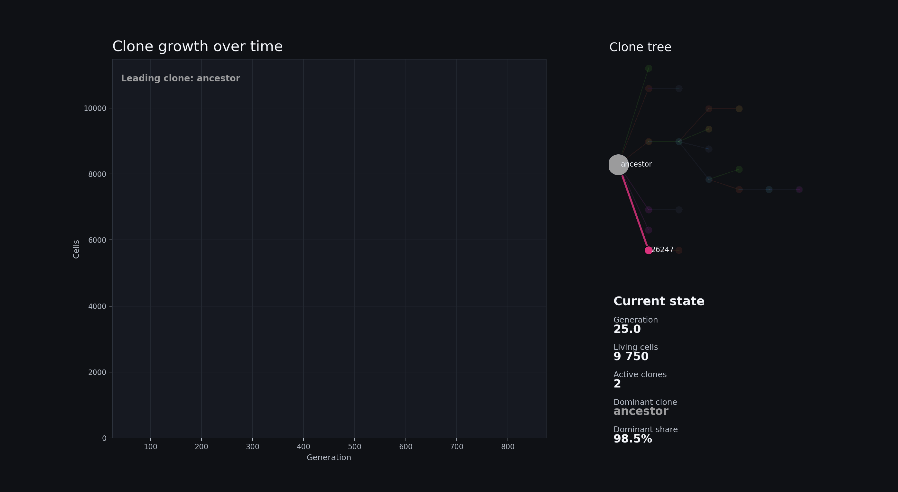

[](https://github.com/dxrgrabowski/CellEvoX/actions/workflows/docker-publish.yml)
# CellEvoX

CellEvoX is a stochastic clonal-population simulator for studying mutation,
selection, and lineage dynamics under a soft carrying capacity. It produces
reproducible population statistics, phylogenies, Muller plots, and 2D/3D
visualizations, and ships with a local React/FastAPI control surface.

Two simulation modes are supported: **2D stochastic tau-leap** and **3D spatial
capacity** (the stochastic model plus an xyz mechanical overlay).

## Documentation

- [AGENTS.md](AGENTS.md) — domain invariants, guardrails, and known tech debt.
- [docs/runbook.md](docs/runbook.md) — build, test, benchmark, and run commands.
- [docs/output-contract.md](docs/output-contract.md) — run outputs and snapshot ABI.
- [docs/adr/](docs/adr/README.md) — why the system is built this way.

## Visualization

### 3D Tumor Growth


### 2D Clone Growth


Both are written under `visualizations/` inside the run directory.

## Quick start

```bash
cmake -B build -S CellEvoX -DCMAKE_BUILD_TYPE=Release
cmake --build build --target CellEvoX CellEvoXTests -j
./build/bin/CellEvoXTests "~[benchmark]"
./build/bin/CellEvoX --config quick_config.json
./build/bin/CellEvoX --analyze output/<run_dir>
```

Docker image: `ghcr.io/dxrgrabowski/cellevox:main` (builds for the target host;
see [ADR-0007](docs/adr/0007-build-portability.md) for portability flags). Build
prerequisites, runtime dependencies and environment settings are in
[docs/runbook.md](docs/runbook.md#build).

## Contact

Dawid Grabowski — dxrsoftware@gmail.com
